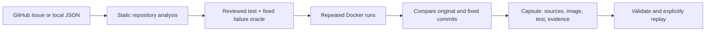

<p align="center">
  
</p>

# Repo Repro

**Turn GitHub Bugs Into Reproducible, Verifiable Capsules.**

Repo Repro captures a GitHub Issue, runs a reviewed test against pinned commits, and packages the evidence with a replayable environment.

[Quick start](#quick-start) · [Demo](#demo) · [Contributing](CONTRIBUTING.md) · [Security](SECURITY.md)

**v0.1.0 is an alpha release.** Execution currently supports Python + pytest on Linux amd64 Docker. A reproduction is an observation under a caller-defined failure oracle, not an automatic proof that an Issue or fix is correct.

The development branch also supports a restricted Go / `go test` workflow, including AI candidates,
verification and Capsule replay. See the [Go guide](docs/go.md) for scope, setup and a historical public case.

## Demo


Recorded from the included calculator fixture: the original commit mishandles empty input; the fixed commit returns zero. Commands and results are real. Playback is shortened for readability and is not a performance benchmark. No model service is used.

## Core features

| | What v0.1.0 does |
| --- | --- |
| **Reproduce Bugs** | Extract Issue context, inspect committed Python files, seal a user test or model candidate, and repeat it in fresh containers. |
| **Verify Fixes** | Run the same test and environment on original/fixed commits; check target failure evidence, repeat consistency, and environment drift. |
| **Replay Anywhere** | Export source snapshots, a frozen image, the test, and its configuration. Replay on a compatible Linux amd64 Docker host with the matching local runner. |
| **Preserve Evidence** | Keep structured pytest reports, stdout/stderr, runtime inventory, resource settings, and content hashes. Export redacted diagnostics. |

## Workflow



Analysis reads Git objects without checking out or executing the target. A model can propose a test; execution evidence determines the result.

## Installation

Requires **Python 3.11+** and **Git**. Execution additionally needs a Linux amd64 Docker daemon with cgroup v2. Analysis, validation, and inspection work without Docker.

Install from a checkout:

```bash
git clone https://github.com/NovolineGast/RepoRepro.git
cd RepoRepro
python -m venv .venv
source .venv/bin/activate
python -m pip install .
repro version
```

On Windows PowerShell, replace the activation line with:

```powershell
.\.venv\Scripts\Activate.ps1
```

If activation is unavailable, use `.\.venv\Scripts\python.exe` and `.\.venv\Scripts\repro.exe` directly. The module entry point is `python -m repo_repro`.

## Quick start

Read the included synthetic Issue without network access:

```bash
repro --help
repro version
repro issue --issue-json examples/issue.json
```

To fetch a public Issue and inspect its current repository:

```bash
repro issue https://github.com/pallets/flask/issues/2751 --output issue.json
repro analyze https://github.com/pallets/flask/issues/2751 --output analysis.json
```

These two commands need GitHub access. `GITHUB_TOKEN` is optional. Analysis alone does not reproduce the historical bug; select the relevant commit for execution.

### Run the complete local demo

The following Bash commands prepare a **test fixture image**, then run reproduction, differential verification, export, validation, and replay:

```bash
docker pull --platform linux/amd64 python:3.11-slim-bookworm
python -m pip download --only-binary=:all: --python-version=3.11 \
  --dest .tools/demo-wheels pytest==9.2.0 pip==26.3 setuptools==84.2.1
python examples/prepare_pytest_image.py \
  --base-image python:3.11-slim-bookworm --wheelhouse .tools/demo-wheels \
  --json > .tools/demo-images.json
python examples/run_demo.py --images .tools/demo-images.json --output .repo-repro/demo
```

Use a fresh output directory each time. The image helper handles reviewed wheel data without executing wheel code on the host. It creates Python 3.11 fixture images and removes the unused GnuTLS library, whose embedded self-test keys would trigger Capsule credential checks. This is not a general dependency installer. See [examples](examples/README.md) for PowerShell and individual commands.

## CLI examples

After the demo, inspect its repository and Capsule:

```bash
repro analyze --issue-json .repo-repro/demo/issue.json \
  --repository-path .repo-repro/demo/repository
repro capsule inspect .repo-repro/demo/case.zip
repro capsule unpack .repo-repro/demo/case.zip .repo-repro/inspection
repro capsule replay .repo-repro/demo/case.zip .repo-repro/replay-again \
  --policy .repo-repro/demo/policy.json
```

The execution commands take explicit input files:

```text
repro generate CONTEXT_JSON --test-file TEST_FILE --artifacts EVIDENCE_DIR --output GENERATED_JSON
repro reproduce REPOSITORY GENERATED_JSON ENVIRONMENT_JSON --commit COMMIT --artifacts EVIDENCE_DIR
repro verify REPOSITORY ORIGINAL_COMMIT FIXED_COMMIT GENERATED_JSON ENVIRONMENT_JSON --artifacts EVIDENCE_DIR
repro capsule export RESULT_JSON NEW_CAPSULE_ZIP --artifacts EVIDENCE_DIR
```

Uppercase arguments are inputs you supply. [The manual demo](examples/README.md#manual-workflow) shows complete commands. `generate --model MODEL_ID` can replace `--test-file`; it sends selected Issue/source/test context to the configured OpenAI-compatible service. Set `OPENAI_API_KEY` through the environment and review what will be sent.

Single-version results distinguish `REPRODUCED`, `NOT_REPRODUCED`, `INCONCLUSIVE`, `ENVIRONMENT_ERROR`, and `TIMEOUT`. Differential success is `DIFFERENTIAL_VALIDATED`; flaky runs, unrelated failures, and missing evidence cannot produce it. Only the selected target test is verified, not the full project's regression suite.

### AI investigation (unreleased)

The development branch adds `repro investigate`: AI interprets the Issue, selects relevant source/test files, and revises candidates using validation errors or original-version execution feedback. Planning and candidate budgets bound the search. The caller's oracle, runtime, and independent verifier stay fixed; fixed-version results are not used to tune candidates.

An optional `--initial-test` lets the model improve a weak existing reproducer. The selected test and ordinary result remain compatible with Capsule export. See the [AI investigation guide](docs/ai-investigation.md) for a complete DeepSeek example, limits, and the real-model validation scope. The v0.1.0 release assets retain their original generator.

## Capsule example

An offline Capsule is a ZIP with one root:

```text
reproduction/
├── repro.yaml                 # Versioned manifest; JSON subset of YAML 1.2
├── checksums.sha256
├── environment.json
├── sources/original.tar
├── sources/fixed.tar          # Present for differential results
├── images/runtime.tar
├── tests/test_reproduction.py
├── evidence/                  # Redacted logs and structured trace
├── reference/result.json
├── README.md
├── report.md
├── Dockerfile                 # Diagnostic only
└── reproduce.sh               # Diagnostic only
```

`validate` and `unpack` check paths, schema, sizes, catalog, and hashes without executing files or loading images. `replay` requires a new workspace and a **local policy**; bundled scripts are never used as the runner. Diagnostic-only Capsules cannot be replayed. SHA-256 detects changes; it does not authenticate a publisher. See the [Capsule format](docs/capsule-v1.md).

## Supported languages

| Language / framework | Status |
| --- | --- |
| Python / pytest | Supported: one simple `test_repro()` with no fixtures, markers, or parametrization. |
| Go / standard-library testing | Unreleased: single pure-Go module; exported function with a scalar return-value assertion. [Guide](docs/go.md). |
| JavaScript, TypeScript, Rust, Java, others | Not implemented. |

The CLI targets Python 3.11–3.14 on Windows and Linux through CI. Sandbox execution and Capsule images currently require Linux amd64. The provided image helper is specific to Python 3.11.

## Security model

- Third-party code runs in Docker, with no network or host mounts, as a non-root user. The root filesystem is read-only; memory, CPU, process, output, workspace, and time limits are enforced and checked.
- Images must already exist locally and be selected by immutable ID/digest. The runner does not pull images or build a target repository's Dockerfile.
- Issue text, generated tests, archives, and logs are untrusted inputs. Test generation is restricted; Capsule extraction rejects traversal, links, duplicates, and oversized payloads.
- Sharing redacts diagnostic text and rejects detected credentials in replay data. Review Capsules before sharing; pattern matching cannot identify every secret. Original private artifacts may contain raw logs.

**Docker is not a complete boundary against hostile code.** Use a disposable VM for high-risk repositories. A malicious target running beside the pytest collector can forge evidence; current results assume a reviewed target and test. See [SECURITY.md](SECURITY.md) for reporting and limits.

## Architecture

```text
CLI
├── github/                 Issue retrieval and deterministic parsing
├── analyzer/               Read-only Git tree and Python project inspection
├── ai/ + reproduction/     Candidate generation, validation, repeated execution
├── sandbox/                Docker lifecycle, snapshots, limits, output capture
├── verification/           Target-failure and differential evidence rules
├── storage/                Content-addressed local artifacts
└── capsule/                Export, validation, extraction, and explicit replay
```

Shared contracts live in `core/`. The AI provider and sandbox use injectable interfaces. Generic report generation and dependency-environment preparation remain unfinished; Capsule replay has its own JSON/Markdown reports.

The development branch exposes trusted `LanguageAdapter` and `TestFrameworkAdapter` registrations through `adapters/`. Run `repro adapters` to inspect the Python/pytest and Go/go-test built-ins. The [adapter guide](docs/adapters.md) describes dispatch and compatibility boundaries.

## Roadmap

- [ ] Prepare and freeze project dependency environments.
- [ ] Support broader pytest fixtures and parametrization.
- [x] Add an initial Go adapter with verification and Capsule replay (unreleased).
- [ ] Broaden Go test shapes and add further language/framework adapters.
- [ ] Add stronger isolation backends and independent evidence collection.
- [ ] Add a SQLite index and general report generation.

## Contributing

Bug reports, focused fixes, documentation, and owned reproduction fixtures are welcome. Start with [CONTRIBUTING.md](CONTRIBUTING.md) and the [Code of Conduct](CODE_OF_CONDUCT.md). CI runs style/type checks, non-Docker tests, real Docker integration, and package installation checks. CI results are visible in [Actions](https://github.com/NovolineGast/RepoRepro/actions).

## License

[MIT](LICENSE). Copyright © 2026 Repo Repro contributors.
